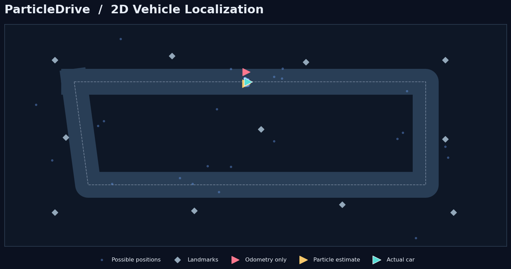

# ParticleDrive

**A self-driving car localization simulator built with a particle filter.**

ParticleDrive is a small, interactive robotics project. A simulated car drives around a map, but the localization algorithm does not know the car's exact position. Instead, it uses noisy movement information and distance measurements to nearby landmarks to estimate where the car is.

The blue dots are *particles*: different guesses about where the car might be. As the car moves, the particle filter updates those guesses and gradually concentrates them around the likely position.



## What you can do

- Watch the **real car (teal)**, **particle filter estimate (yellow)**, and **odometry-only estimate (pink)** move around the map. The arrows are smaller so they do not cover the particle cloud.
- **Hide or show the car arrows** and adjust **particle dot size** while the simulation is running. The blue particles are drawn on top of the arrows so they remain visible.
- Change the number of particles or amount of sensor noise.
- Turn the sensors off and see how position estimates drift without corrections.
- Teleport the real car unexpectedly to test how well the filter recovers.
- Compare the localization error of a particle filter against wheel odometry alone.

The display controls only change how the map is drawn; they do **not** change particle filter calculations or reset the simulation.

## How the algorithm works

The filter repeats four steps:

1. **Predict:** Move every particle according to the reported movement, adding some random error. Real vehicle movement isn't perfectly known.
2. **Measure:** The simulated car measures its distance to landmarks. Those measurements also contain random error.
3. **Weight and resample:** Compare each particle's predicted measurements to the observations. Positions that match the measurements better get a higher weight. Resampling copies more likely particles and removes unlikely ones.
4. **Estimate:** Average the particle positions to produce an estimated car location. Heading uses a circular average so that +179° and −179° count as nearby directions.

The likelihood calculation uses **log probabilities** to avoid numerical underflow, and resampling uses **systematic resampling**, which is more predictable than independently drawing every particle.

This is a **Monte Carlo localization** demonstration, not a full autonomous driving stack. The car follows a predefined waypoint route; the particle filter estimates its pose rather than steering it.

## Run locally

Requires **Python 3.10+**.

```bash
python -m venv .venv
```

Activate the environment:

- Windows PowerShell: `.\.venv\Scripts\Activate.ps1`
- macOS/Linux: `source .venv/bin/activate`

Install dependencies and start the app:

```bash
python -m pip install -r requirements.txt
python -m uvicorn particledrive.api:app --reload
```

Open **http://127.0.0.1:8000**.

If PowerShell prevents activation, use `\.venv\Scripts\python.exe` in place of `python` for the final two commands.

## Test the algorithm

```bash
python -m pip install -r requirements-dev.txt
python -m pytest -q
```

Tests cover movement, angle wrapping, particle count, measurement likelihoods, resampling, simulation steps, sensor dropout, and unexpected relocation.

## Project structure

```text
ParticleDrive/
├── particledrive/
│   ├── filter.py        # Particle-filter math
│   ├── simulation.py    # Real car, sensors, and comparison baseline
│   └── api.py           # FastAPI endpoints
├── web/
│   ├── index.html       # Web interface
│   ├── style.css
│   └── app.js           # Visualization and controls
├── tests/
├── assets/
└── requirements.txt
```

## Technologies

Python, NumPy, FastAPI, JavaScript, HTML, CSS, and pytest.

## Limitations

- This simulator uses fixed landmarks and synthetic range measurements; it does not process real lidar, cameras, or GPS data.
- The vehicle follows a fixed route, rather than making its own path-planning decisions.
- The filter can temporarily become inaccurate after a sudden relocation or a long sensor outage. Small numbers of randomly injected particles help it recover, but convergence is not guaranteed.
- Localization error is displayed in **map pixels**, not physical meters.

Built to make probabilistic localization easy to see and understand.
